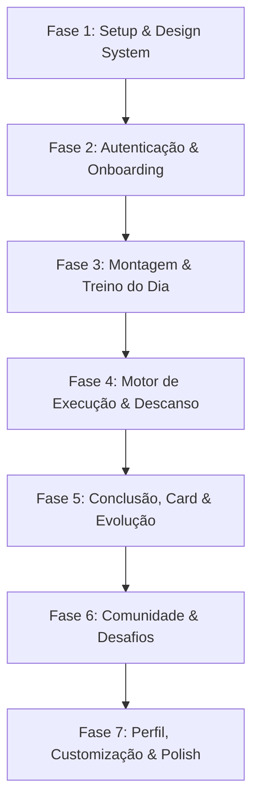

# Plano de Implementação - Rep a Rep (React Native + Expo)

> **Documento:** Plano de Arquitetura e Engenharia de Front-end  
> **Status:** Pronto para Execução  
> **Base de Referência:** [PRD - Rep a Rep.pdf](file:///c:/Code/projetos/Rep%20a%20Rep/references/PRD%20-%20Rep%20a%20Rep.pdf), [Mapa Visual Rep a Rep.pdf](file:///c:/Code/projetos/Rep%20a%20Rep/references/Mapa%20Visual%20Rep%20a%20Rep.pdf) e protótipo Figma/React em [references/Develop 20 Screens](file:///c:/Code/projetos/Rep%20a%20Rep/references/Develop%2020%20Screens).

---

## 1. Visão Geral & Objetivos do MVP

O **Rep a Rep** é um aplicativo de musculação focado no público iniciante a intermediário (20–30 anos, até 2 anos de treino), com foco em **autonomia, consistência e evolução pessoal** ("uma rep de cada vez"), sem comparações tóxicas nem excesso de métricas complexas.

### Objetivos Técnicos do MVP:
1. **Fidelidade Visual & UX:** Migrar fielmente as 20 telas concebidas no protótipo Figma para componentes nativos fluidos em **React Native + Expo**.
2. **Navegação Enxuta:** Estrutura estrita com **2 abas principais na barra inferior** (`Treino` e `Comunidade`) e acesso ao `Perfil` fixo no canto superior direito (com suporte a fluxo modal/stack).
3. **Modo Visitante ("Guest First"):** Permitir montagem e execução do primeiro treino sem cadastro prévio, convidando à criação de conta ao final para salvar progresso e acessar a Comunidade.
4. **Execução de Treino com Baixa Fricção:** Registro instantâneo de séries/cargas com comparação imediata contra a sessão anterior e cronômetro de descanso ativo in-screen/bottom-sheet.
5. **Viral Loop & Compartilhamento:** Geração nativa de cards verticais estilo Stories (1080x1920) para salvamento em galeria e compartilhamento nativo.

---

## 2. Stack Tecnológica Recomendada

| Camada | Tecnologia | Justificativa |
| :--- | :--- | :--- |
| **Framework Base** | **Expo (SDK 52+)** com **TypeScript** | Modo Managed, rápido ciclo de desenvolvimento com Expo Go / Dev Client, suporte completo a iOS e Android. |
| **Roteamento** | **Expo Router v4** (file-based) | Navegação declarativa baseada em diretórios, suporte nativo a deep links, modais e transições fluidas. |
| **Estilização** | **NativeWind (v4 / Tailwind CSS)** + **StyleSheet** | Manutenção direta dos tokens de cor, tipografia e espaçamento já presentes no Tailwind/CSS do protótipo Figma. |
| **Ícones Vetoriais** | **Lucide Icons (`lucide-react-native`)** | Linha estética idêntica à do Figma (moderna, clean, geométrica e com controle de strokeWidth). |
| **Gerenciamento de Estado** | **Zustand** | Leve, intuitivo, sem boilerplate excessivo; ideal para gerenciar sessão de treino ativa, perfil e cache local. |
| **Persistência Local** | **AsyncStorage** ou **MMKV (`react-native-mmkv`)** | Para preservar treinos montados, histórico de séries e perfil no modo visitante e offline. |
| **Geração de Imagens** | **`react-native-view-shot`** + **`expo-sharing`** | Renderização em off-screen/view do card vertical de conquistas para compartilhar no Instagram Stories / WhatsApp. |
| **Feedback Tátil & Som** | **`expo-haptics`** | Feedback tátil imediato ao concluir uma série ou ao terminar o descanso ativo. |

---

## 3. Design System & Design Tokens

Baseado estritamente nas especificações do PRD e nos tokens extraídos do [index.css](file:///c:/Code/projetos/Rep%20a%20Rep/references/Develop%2020%20Screens/src/index.css):

### 3.1 Cores
* **Ink / Dark Base:** `#121318` (Backgrounds escuros, botões primários, textos fortes)
* **Ink-2:** `#20222A` (Bordas e cards dark)
* **Paper / Light Canvas:** `#F7F7F9` (Fundo padrão da aplicação)
* **Surface White:** `#FFFFFF` (Fundo de cards e modais)
* **Line / Divider:** `#E6E7EC`
* **Muted / Text Secondary:** `#6F7280`
* **Brand Accent Blue:** `#3759F9` (Destaques, botões ativos, acentos)
* **Brand Blue Dark:** `#2543D8`
* **Brand Accent Purple:** `#7B4DF7` (Gradientes pontuais de conquista)
* **Violet Soft:** `#EEE9FF` (Badges e tags)
* **Success Green:** `#20A575` (Séries concluídas)
* **Alert / Danger:** `#DC4D58`

### 3.2 Tipografia
* **Família:** `Manrope` (pesos: 400 Regular, 500 Medium, 600 SemiBold, 700 Bold, 800 ExtraBold).
* **Escala:**
  * Eyebrow: 10px / Uppercase / Letter spacing 1.3
  * Body Small / Muted: 12-13px
  * Body Base: 14-15px
  * Card Titles: 16-18px Bold
  * Hero Headings: 28-32px ExtraBold (-0.04em letter spacing)

### 3.3 Componentes Fundamentais (UI Kit)
* `Button`: Variantes `primary`, `secondary`, `ghost`, `danger`. Suporte a ícone à esquerda e feedback tátil.
* `Chip`: Seletores em formato pill com estado ativo/inativo.
* `ProgressBar`: Linha com gradiente Blue -> Purple.
* `Avatar`: Componente customizado com cenário/moldura e tamanhos `sm` (34px), `md` (42px) e `lg` (86px).
* `AppHeader`: Cabeçalho padrão com botão Voltar ou Logo, título central e botão de Avatar no canto direito.
* `NumberInput`: Campo otimizado para teclado numérico com botões de incremento/decremento rápido.

---

## 4. Arquitetura de Navegação (Expo Router)

A arquitetura respeita estritamente o princípio do PRD: **apenas 2 abas inferiores** (`Treino` e `Comunidade`), com o **Perfil** acessível via topo.

```
app/
├── _layout.tsx                     # Root Layout: Provider de Estado, Splash, Fonts Manrope
├── (auth)/                         # Fluxo inicial e boas-vindas
│   ├── welcome.tsx                 # [Tela 01] Boas-vindas e acesso (Criar conta / Entrar / Visitante)
│   ├── login.tsx                   # [Tela 02] Entrar / Criar conta (simulado c/ Google & Apple)
│   └── onboarding.tsx              # [Tela 03] Onboarding em 4 etapas (Nome, Idade, Gênero, Nível)
├── (workout-setup)/                # Fluxo de montagem de treino
│   ├── preferences.tsx             # [Tela 04] Objetivo, frequência, local e equipamentos
│   ├── structure.tsx               # [Tela 05] Escolha da estrutura (Full Body, Upper/Lower, PPL)
│   ├── exercises.tsx               # [Tela 06] Seleção e substituição de exercícios por categoria
│   └── review.tsx                  # [Tela 07] Resumo semanal, aviso de edições livres e salvar
├── (tabs)/                         # Navegação Principal (Bottom Tabs)
│   ├── _layout.tsx                 # Bottom Navigation (Apenas Treino e Comunidade)
│   ├── (workout)/                  # Aba 1: Treino
│   │   └── index.tsx               # [Tela 08] Treino do Dia (Hoje), consistência e histórico
│   └── (community)/                # Aba 2: Comunidade
│       ├── index.tsx               # [Tela 14] Feed social, banners de desafios e posts
│       ├── challenge/[id].tsx      # [Tela 15] Detalhe de desafio coletivo
│       └── create-challenge.tsx    # [Tela 16] Formulário de criação de desafio + limite Free
├── workout/                        # Sessão de treino ativa (Modo imersivo sem Bottom Tab)
│   ├── active.tsx                  # [Tela 09] Execução: séries, carga, repetições, último treino
│   ├── rest-modal.tsx              # [Tela 10] Descanso ativo (Timer circular + -15s/+15s)
│   ├── summary.tsx                 # [Tela 11] Resumo da sessão (Volume, REP milestone, recordes)
│   └── share-card.tsx              # [Tela 12] Card vertical compartilhável (Story exportável)
├── profile/                        # Modais e Telas de Perfil (Acesso via Header)
│   ├── index.tsx                   # [Tela 17] Perfil: Capa de anéis, avatar, conquistas e atalhos
│   ├── progress.tsx                # [Tela 13] Evolução: gráficos de frequência, volume e cargas
│   ├── customize.tsx               # [Tela 18] Personalização: Catálogo de retratos, molduras e cenários
│   ├── plans.tsx                   # [Tela 19] Planos Free / Premium / Creator com paywall demo
│   └── settings.tsx                # [Tela 20] Configurações, notificações, termos e aviso médico
```

---

## 5. Mapeamento Detalhado das 20 Telas

| # | Tela | Rota Expo | Requisitos & Interações Principais |
| :-: | :--- | :--- | :--- |
| **01** | **Boas-vindas** | `/(auth)/welcome` | Logo animado com anéis, slogan do produto, botões "Criar conta", "Entrar" e atalho direto "Experimentar sem conta". |
| **02** | **Entrar / Criar conta** | `/(auth)/login` | Toggle entre Cadastro e Login, botões Apple/Google, simulação de validação de e-mail/senha com mensagem de erro e sucesso. |
| **03** | **Onboarding** | `/(auth)/onboarding` | 4 passos lineares (Nome, Idade, Identidade de gênero, Nível de experiência). Opção de pular configuração no final. |
| **04** | **Preferências de Treino** | `/(workout-setup)/preferences` | 3 etapas: Objetivo principal, Frequência semanal (com seletor de duração) e Local/Equipamentos disponíveis (com chips multi-seleção). |
| **05** | **Escolha da Estrutura** | `/(workout-setup)/structure` | Cards de divisão (Full Body / Upper-Lower / Push-Pull-Legs) com tags de recomendação e dias sugeridos. |
| **06** | **Escolha de Exercícios** | `/(workout-setup)/exercises` | Agrupamento por movimento (Agachar, Empurrar, Puxar, etc.), modal para troca/substituição por alternativa compatível. |
| **07** | **Revisão do Treino** | `/(workout-setup)/review` | Cronograma semanal (A/B), aviso explicativo de que edições de treino não consomem limite mensal de montagens. |
| **08** | **Treino do Dia** | `/(tabs)/(workout)/index` | Saudação dinâmica, card com banner do treino atual (exercícios e tempo previsto), indicador de semanas de consistência (dias da semana). |
| **09** | **Execução do Treino** | `/workout/active` | Foco em 1 exercício por vez, tabela de séries interativa (Carga x Reps), comparação com a sessão anterior, botão de descanso integrado. |
| **10** | **Descanso Ativo** | `/workout/rest-modal` | Bottom sheet ou modal com timer regressivo SVG/circular animado, botões de ajuste (-15s / +15s), pause e retorno sem perda de dados. |
| **11** | **Resumo Pós-Treino** | `/workout/summary` | Efeito de confete, celebração do marco REP (ex.: `REP 001` ou `012`), cards de volume total, novo recorde pessoal e tempo. |
| **12** | **Card Compartilhável** | `/workout/share-card` | Renderização de card vertical 9:16 de alta definição (recorde, duração, frase motivacional e assinatura de marca) com botão nativo de compartilhar/salvar. |
| **13** | **Evolução** | `/profile/progress` | Filtros por período (4 sem, 3 meses, ano), gráfico de consistência (barras), evolução de carga do supino (linha com curva) e marcos REP. |
| **14** | **Comunidade / Feed** | `/(tabs)/(community)/index` | Banner do Desafio Oficial do mês, feed de conquistas sem comentários (apenas curtidas e compartilhamento), filtro "Para você" / "Seguindo". |
| **15** | **Detalhe de Desafio** | `/(tabs)/(community)/challenge/[id]` | Progresso pessoal vs progresso coletivo, contagem de participantes, medalha oficial bloqueada/desbloqueada e convite de amigos. |
| **16** | **Criar Desafio** | `/(tabs)/(community)/create-challenge` | Formulário rápido com modelos prontos (12 treinos em 30 dias), aviso de limites do plano Free (1 desafio / até 10 amigos) e tela de sucesso com código. |
| **17** | **Perfil do Usuário** | `/profile/index` | Header visual com anéis concêntricos proprietários, marco REP do usuário, estatísticas gerais, atalhos rápidos e lista de conquistas. |
| **18** | **Personalização de Perfil** | `/profile/customize` | Prévia em tempo real do avatar e capa; abas para Retratos, Molduras, Cenários e Itens, com badges e prévias exclusivas do plano Premium. |
| **19** | **Planos e Limites** | `/profile/plans` | Comparação das vantagens Free, Premium e Creator Pro; marcador de uso das montagens mensais (ex.: 3 de 4 utilizadas) sem checkout real. |
| **20** | **Configurações e Termos** | `/profile/settings` | Switches de notificação, dados da conta, links de Termos de Uso e Política, e destaque obrigatório para o Aviso de Responsabilidade em saúde. |

---

## 6. Arquitetura de Dados & Mock Stores (Zustand)

Para garantir fluidez imediata e permitir testar a jornada ponta a ponta sem backend real:

### 6.1 `useWorkoutStore`
```typescript
interface ExerciseSet {
  id: string;
  setNumber: number;
  weight: number;
  reps: number;
  completed: boolean;
}

interface ActiveExercise {
  id: string;
  name: string;
  category: 'AGACHAR' | 'EMPURRAR' | 'PUXAR' | 'QUADRIL';
  equipment: string;
  previousRecord?: { weight: number; reps: number };
  sets: ExerciseSet[];
}

interface WorkoutStore {
  currentProgram: any | null;
  activeWorkout: {
    title: string;
    exercises: ActiveExercise[];
    startedAt: Date | null;
    currentExerciseIndex: number;
  } | null;
  monthlyBuildsUsed: number;
  startWorkout: () => void;
  updateSet: (exerciseIndex: number, setIndex: number, data: Partial<ExerciseSet>) => void;
  finishWorkout: () => WorkoutSummaryData;
}
```

### 6.2 `useUserStore`
* Guarda dados do usuário (Nome, Idade, Nível, Avatar escolhido, Cenário ativo).
* Flag `isGuest: boolean`.
* Histórico de treinos concluídos e contador de marcos `repMilestone` (iniciando em `REP 001`).

### 6.3 `useCommunityStore`
* Feed de postagens mockadas com persistência de curtidas locais.
* Lista de desafios ativos (Oficiais e Criados pelo Usuário) com contador de progresso.

---

## 7. Cronograma e Fases de Implementação



### Fase 1: Setup de Infraestrutura & Tokens Visuais (1–2 dias)
- Inicialização do projeto com Expo (`npx create-expo-app@latest`).
- Instalação e configuração do NativeWind v4, `Manrope` via `expo-font`, e `lucide-react-native`.
- Criação dos componentes base em `src/components/ui/` (`Button`, `Chip`, `ProgressBar`, `Avatar`, `AppHeader`).

### Fase 2: Entrada, Autenticação e Onboarding [Telas 1–3] (2 dias)
- Implementação de `welcome.tsx` com a arte gráfica dos anéis orbitais e CTA de Visitante.
- Tela `login.tsx` com estados de alternância entre cadastro/login e tratamento de erro visual.
- Stepper do `onboarding.tsx` em 4 etapas com transições animadas.

### Fase 3: Montagem de Treino & Home do Usuário [Telas 4–8] (3 dias)
- Telas de Preferências (`preferences.tsx`), Escolha de Estrutura (`structure.tsx`) e Exercícios (`exercises.tsx`).
- Modal para substituir exercícios respeitando o padrão de movimento.
- Tela de Revisão (`review.tsx`) e criação da Home da aba Treino (`today.tsx`) com o card principal e os dias de consistência.

### Fase 4: Experiência Central de Treino [Telas 9–10] (3 dias)
- Construção da tela de Execução (`active.tsx`):
  - Interface otimizada para mínima fricção táctil.
  - Tabela rápida de séries com inputs numéricos e indicador de conclusão com `expo-haptics`.
  - Comparação clara com a sessão anterior.
- Descanso ativo (`rest-modal.tsx`) com anel de progresso SVG animado e botões de +/- 15 segundos.

### Fase 5: Conclusão, Compartilhamento & Evolução [Telas 11–13] (2–3 dias)
- `summary.tsx` com cálculo dinâmico de volume, celebração do marco REP e recordes batidos.
- `share-card.tsx` com `react-native-view-shot` e `expo-sharing` para gerar imagens prontas para Stories.
- `progress.tsx` com gráficos de frequência (barras) e linha de carga do supino.

### Fase 6: Comunidade e Desafios Colaborativos [Telas 14–16] (2 dias)
- Feed da comunidade com cards de treino concluído e marcos.
- Tela de detalhe do desafio oficial com barra de progresso individual e coletivo.
- Formulário de criação de desafio com validação de limite do plano Free.

### Fase 7: Perfil, Personalização, Planos e Ajustes Finais [Telas 17–20] (2–3 dias)
- Perfil com cenário gráfico e atalhos rápidos.
- Tela interativa de personalização com catálogo de molduras e cenários com prévia em tempo real.
- Comparativo de Planos (Free vs Premium vs Creator) e tela de Configurações com o Aviso de Responsabilidade.
- Testes manuais de usabilidade em emuladores Android e iOS.

---

## 8. Critérios de Aceite e Validação do MVP

* [ ] O app permite navegar do início ao fim como Visitante sem exigir conta.
* [ ] A barra inferior possui **apenas 2 abas** (`Treino` e `Comunidade`).
* [ ] A tela de execução permite registrar séries e acionar o descanso em menos de 2 toques.
* [ ] A comparação com a sessão anterior só aparece quando houver histórico do exercício.
* [ ] O card vertical de compartilhamento é gerado com sucesso e exportável para galeria/redes.
* [ ] O aviso de responsabilidade em saúde está claramente acessível nos termos e configurações.
* [ ] Os limites do plano Free e as prévias dos recursos Premium são demonstrados sem simular cobrança real.
